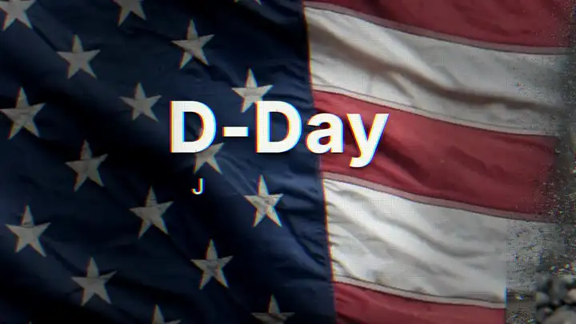

# parallax-doc

Short history documentaries in one continuous camera move, made by your coding agent.

[](https://github.com/sanskarprajapati/parallax-doc/releases/download/v0.1.0/dday-example.mp4)

*The first 14 seconds of the D-Day example. [Watch the full 1-minute film (with sound)](https://github.com/sanskarprajapati/parallax-doc/releases/download/v0.1.0/dday-example.mp4).*

**parallax-doc** is a [Claude Code](https://claude.com/claude-code) plugin. It teaches
the agent one documentary style and gives it the tools and scene blocks to build that
style for any topic. You say *"make a 60 second documentary about the Berlin Airlift"*;
it writes the script, voices it, generates the images, builds the scenes and renders an
MP4.

The style:

- **One camera, no cuts.** The camera never stops, and the scenes never cut. The picture
  changes behind a column of spray, behind a stone cross passing the lens, inside a
  newspaper photo the camera zooms into, or under a calendar date it dives through.
- **Real depth.** Every scene has 3–5 layers of archival-style and AI images, each
  moving at its own parallax.
- **Typed text with one red word.** Each line is in a calligraphic serif, typed letter
  by letter as the narrator says it. One word per line glows red. The text sits in the
  scene itself: behind a headstone, flat on a war-room table, pinned to a map.
- **A worn film look.** Desaturated and cool, with a heavy vignette, grain, dust,
  vertical scratches, a fine dot grid and a slight colour split.

The scenes are HTML, animated with GSAP and rendered frame-exact by
[HyperFrames](https://hyperframes.heygen.com). Every move is code you can open and change.

## Install

In Claude Code:

```
/plugin marketplace add sanskarprajapati/parallax-doc
/plugin install parallax-doc@parallax-doc
```

Then install what the tools need:

| Need | Get it |
|---|---|
| Node.js 18+ | [nodejs.org](https://nodejs.org) (the HyperFrames CLI runs through `npx`) |
| ffmpeg | `brew install ffmpeg` or `apt install ffmpeg` |
| Python 3.9+ with Pillow, NumPy and SciPy | `python3 -m pip install -r plugin/skills/parallax-doc/requirements.txt` |
| An OpenRouter key, for images | [openrouter.ai/keys](https://openrouter.ai/keys), then `export OPENROUTER_API_KEY=...` |
| A narration voice | Any TTS (ElevenLabs works well), a free local voice (`npx hyperframes tts`), or your own recording |

To confirm everything is in place, ask Claude to *"run the parallax-doc setup check"*,
or run `plugin/skills/parallax-doc/scripts/check_setup.sh` yourself.

## Make a film

Ask for one:

> Make a 60 second parallax-doc documentary about why the Berlin Wall fell in 1989.

The agent follows the workflow in [`SKILL.md`](plugin/skills/parallax-doc/SKILL.md):

1. **Script.** It writes about 135 words with a turn in the middle ("that's not in
   question… what is"), fact-checks every claim, and waits for your OK.
2. **Voice.** It records one take, then fits it to the length. Long pauses are
   shortened, the speed is adjusted slightly, and word timings come back for every word.
3. **Images.** It writes one prompt per image and generates them through OpenRouter
   (about $0.014 each). Foreground layers are generated on plain white, so they cut out
   cleanly without an AI matte.
4. **Scenes.** It picks a block for each beat, fills in the images, text and camera
   numbers, and times every typed line to its word.
5. **Render and review.** It renders the scenes, applies the film look and checks every
   hand-off frame by frame. You get a 1080p MP4 and a 720p preview.

A 60 second film costs about $0.30 in images, plus your voice. Rendering is local:
about two minutes on a recent Mac.

You can also give it a reference video: *"break down this video frame by frame and make
one in its style"*. It studies every frame first, then builds to match
([`analyze-reference.md`](plugin/skills/parallax-doc/references/analyze-reference.md)).

## The blocks

Each block is one scene with its numbers in a `CONFIG` object at the top.

| Block | What it does |
|---|---|
| `title-open` | A waving flag or banner, archival figures rising into frame, a heavy title and a typed date, with the camera pulling back off the title |
| `seam-pass` | A truck past a column of spray, with the new world on the far side. Ends with a boom-up: the near layer sinks while the far one pushes in |
| `object-wipe` | A huge soft object passes the lens and the new world opens behind it. Text can sit behind something in the image |
| `handheld-paper` | A newspaper or telegram held in two hands. It leaves by zooming into a printed photo, or by dropping away to reveal a desk |
| `plate-push` | The workhorse: one image with a moving camera, text, an optional object passing in front, shake, a red line, and a dive into a detail to leave |
| `map-route` | An old map with a glowing red route; the camera follows it, then zooms into a photo pinned at the end |
| `calendar-dive` | A real month built in HTML, red pen from one date to another, then a dive into the date |
| `cover-pass` | Something wider than the frame rolls past and the world changes behind it. Text lines in turn, then a fade to black |

## Example

[`examples/dday`](examples/dday) is the 60 second film the style was built on: all 11
scene files, all 22 image prompts and the full script. Images and audio aren't included;
regenerating them costs about $0.30.

## Repository layout

```
.claude-plugin/marketplace.json     marketplace entry (install source)
plugin/
  .claude-plugin/plugin.json
  skills/parallax-doc/
    SKILL.md                        the workflow the agent follows
    references/                     style numbers, hand-offs, blocks, images, voice, review
    blocks/                         the scene blocks
    template/film, template/finish  the two HyperFrames projects a new film starts from
    scripts/                        new_film, add_scene, gen_plates, cut_layers,
                                    fit_voice, make_bed, render, frames, check_setup
examples/dday/                      the D-Day film: scenes, image prompts, script
```

## Licence

MIT, see [LICENSE](LICENSE). The bundled Cormorant Upright font is licensed under the
SIL Open Font License 1.1.

The images and voices you generate are subject to the terms of the services that made
them. Real people in AI images are reconstructions; say so when you publish.
